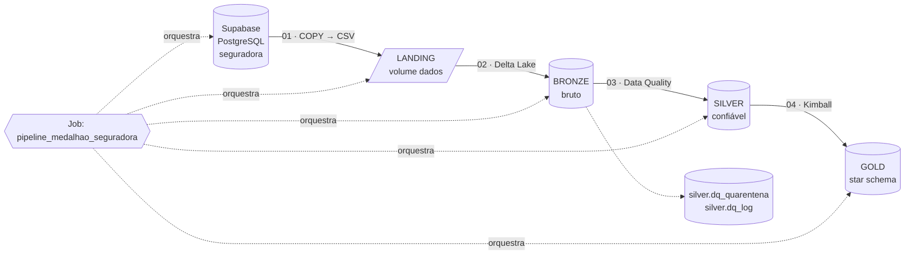
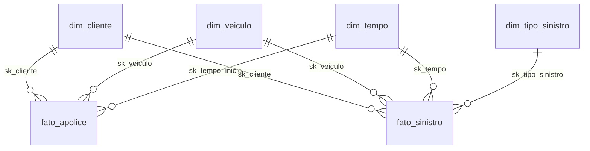

# Lakehouse com Databricks e Arquitetura Medalhão

## Descrição

Pipeline de dados no **Databricks Free Edition** que extrai todas as tabelas do banco **`seguradora`** (PostgreSQL hospedado no **Supabase**), grava os arquivos em CSV na **landing**, converte para **Delta Lake** na **bronze**, aplica **Data Quality** na **silver** e alimenta um **modelo dimensional (Ralph Kimball)** na **gold**. As cinco etapas são encadeadas por um **Job** (Jobs & Pipelines).

Trabalho 3 de Engenharia de Dados (UNISATC), Prof. Jorge Luiz da Silva. Complementa os trabalhos anteriores: [Spark com Delta Lake e Iceberg](https://github.com/raffaelarcego/trabalho-apachespark-eng_dados) e [SQL Server → MinIO → Delta Lake](https://github.com/isabellefeltrin/Rafa-Isa-spark-delta-minio-sqlserver), cujo banco `seguradora` foi migrado para o Supabase e ampliado.

**Integrantes:** Raffael Michels Arcego · Isabelle Luiz Feltrin

📖 **Documentação completa:** https://isabellefeltrin.github.io/Rafa-Isa-lakehouse-databricks-supabase/



## Camadas

| Camada | Onde | Conteúdo |
|---|---|---|
| **Landing** | volume `workspace.landing.dados` | Um CSV por tabela, extraído do Supabase |
| **Bronze** | schema `workspace.bronze` | Cópia fiel em Delta, tudo `STRING`, com colunas de auditoria |
| **Silver** | schema `workspace.silver` | Dados tipados, padronizados, deduplicados e validados; rejeitados vão para `dq_quarentena` |
| **Gold** | schema `workspace.gold` | `dim_tempo`, `dim_cliente`, `dim_veiculo`, `dim_tipo_sinistro`, `fato_apolice`, `fato_sinistro` |

## Disclaimer

- O **Databricks Free Edition** só tem compute serverless e limita a saída de rede a [domínios confiáveis](https://docs.databricks.com/aws/en/getting-started/free-edition-limitations). Se a conexão com o Supabase for bloqueada, use o [Plano B](#plano-b-saída-de-rede-bloqueada).
- Use a URI do **Session pooler** do Supabase. A *Direct connection* funciona só em IPv6.
- O banco tem registros **sujos de propósito** (CPF com máscara, placa minúscula, prêmio negativo, sinistro duplicado etc.) para demonstrar as regras de Data Quality.
- A senha do banco **nunca** vai para o código: fica em um secret do Databricks (`seguradora/pg_uri`) ou no `.env` local, que está no `.gitignore`.

## Pré-requisitos

- Conta gratuita no [Supabase](https://supabase.com)
- Conta no [Databricks Free Edition](https://www.databricks.com/learn/free-edition)
- Conta no GitHub
- Para o Plano B e o MkDocs local: **[uv](https://docs.astral.sh/uv/)**

| Componente | Versão |
|---|---|
| Databricks | Free Edition (serverless) |
| PostgreSQL | 15+ (Supabase) |
| psycopg2-binary | 2.9.10 |
| databricks-sdk | ≥ 0.40 (Plano B) |
| mkdocs + material | 1.6 + 9.x |

## Howto

### 1. Banco de origem no Supabase

1. No Supabase, clique em **New project**, dê o nome `seguradora` e anote a senha do banco.
2. Abra **SQL Editor → New query**, cole o conteúdo de [`sql/01_seguradora_postgres.sql`](sql/01_seguradora_postgres.sql) e clique em **Run**. Confirme o aviso de operação destrutiva (o script faz `DROP TABLE IF EXISTS`).
3. A consulta final deve mostrar `marca 9 · cliente 40 · carro 60 · apolice 76 · sinistro 48`. As tabelas aparecem em **Table Editor**.
4. Clique em **Connect** (topo da página) e copie a URI do **Session pooler**:

   ```
   postgresql://postgres.<id-do-projeto>:<senha>@aws-0-<regiao>.pooler.supabase.com:5432/postgres
   ```

   Acrescente `?sslmode=require` no final. Se a senha tiver caracteres especiais, codifique-os (`@` → `%40`, `#` → `%23`).

> Os dados foram gerados por [`scripts/gerar_dados.py`](scripts/gerar_dados.py) (semente fixa, sempre o mesmo resultado).

### 2. Repositório no Databricks

1. No Databricks: **Workspace → Create → Git folder**, cole a URL deste repositório e confirme. Os notebooks ficam em `/Workspace/Users/<seu-email>/Rafa-Isa-lakehouse-databricks-supabase/notebooks/`.
2. Crie o secret com a URI do Supabase. Em um notebook **temporário** (não salve no repositório), rode:

   ```python
   from databricks.sdk import WorkspaceClient
   w = WorkspaceClient()
   w.secrets.create_scope(scope="seguradora")
   w.secrets.put_secret(scope="seguradora", key="pg_uri", string_value="postgresql://...?sslmode=require")
   ```

   Depois apague o notebook. Se o secret não estiver disponível, o notebook 01 aceita a URI pelo widget `pg_uri` (não faça commit dela).

### 3. Execução manual (teste)

Rode os notebooks em ordem, cada um com **Run all**:

| Notebook | O que faz |
|---|---|
| `00_setup` | Cria os schemas `landing`, `bronze`, `silver`, `gold` e o volume `landing.dados` |
| `01_extracao_landing` | Descobre todas as tabelas do Supabase e grava um CSV por tabela no volume |
| `02_bronze` | Lê os CSVs e grava tabelas Delta (tudo `STRING` + `_ingestion_ts`, `_source_file`, `_batch_id`) |
| `03_silver` | Tipagem, padronização, deduplicação e regras de negócio; rejeitados vão para `dq_quarentena` |
| `04_gold` | Constrói o star schema, valida a integridade e mostra consultas de exemplo |

`_config` é incluído pelos demais via `%run` e centraliza catálogo, schemas e caminhos.

### 4. Job (Jobs & Pipelines)

1. **Jobs & Pipelines → Create → Job**.
2. Adicione 5 tasks do tipo **Notebook**, cada uma dependendo da anterior: `setup → extracao_landing → bronze → silver → gold`.
3. Em **Job parameters**, crie `catalogo = workspace` e `modo_extracao = supabase`.
4. Clique em **Run now** e aguarde as 5 tasks ficarem verdes.

A definição completa do Job está em [`jobs/job_medalhao.yml`](jobs/job_medalhao.yml). Ela pode ser colada no editor YAML do Job (menu **⋮**) ou usada com Databricks Asset Bundles. Os caminhos dos notebooks apontam para `/Workspace/Users/isalufeltrin@gmail.com/...`: troque pelo e-mail da sua conta antes de usar.

### Plano B: saída de rede bloqueada

Se o notebook 01 falhar com erro de conexão, a extração roda no seu computador e envia os CSVs para o volume pela API do Databricks:

```bash
uv sync
cp .env.example .env       # preencha PG_URI, DATABRICKS_HOST e DATABRICKS_TOKEN
uv run python scripts/extrair_supabase_para_volume.py
```

O token é criado em **Settings → Developer → Access tokens**. Depois, rode o Job com `modo_extracao = upload_externo`: o notebook 01 passa a só validar a landing, e o restante do pipeline é idêntico.

## Data Quality (resumo)

| Tabela | Correções | Rejeições |
|---|---|---|
| marca | trim, maiúsculas | id/nome nulos, duplicados |
| cliente | nome em Inicial Maiúscula, CPF só dígitos, cidade/UF padronizadas, e-mail inválido → NULL | CPF inválido (formato ou dígito verificador), nascimento futuro, menor de 18 anos |
| carro | placa maiúscula sem hífen, cor nula → `NAO INFORMADA` | placa fora do padrão antigo/Mercosul, ano fora de 1950..ano+1 |
| apolice | tipagem `DECIMAL`/`DATE` | prêmio ≤ 0, vigência invertida, início futuro |
| sinistro | tipo sem acento e em maiúsculas | tipo desconhecido, valor ≤ 0 ou nulo, data futura, fora da vigência, apólice inexistente, evento duplicado |

Resultado da execução: 16 registros rejeitados de 233 (detalhes em `silver.dq_quarentena` e `silver.dq_log`).

## Modelo dimensional (Gold)



- **fato_apolice** (grão: 1 apólice): `valor_premio`, `vigencia_dias`
- **fato_sinistro** (grão: 1 sinistro): `valor_sinistro`, `qtd_sinistro`
- Chaves substitutas, membro desconhecido (`-1`), marca desnormalizada em `dim_veiculo`, SCD Tipo 1.

## Documentação (MkDocs)

```bash
uv run mkdocs serve       # visualizar localmente em http://127.0.0.1:8000
uv run mkdocs gh-deploy   # publicar no GitHub Pages
```

Na primeira publicação, ative em **Settings → Pages → Branch: `gh-pages`**.

## Problemas comuns

<details>
<summary><b><code>could not translate host name</code> ou <code>Network is unreachable</code></b> no notebook 01</summary>

A URI usada é a *Direct connection* (IPv6). Troque pela URI do **Session pooler** em **Connect** no Supabase.

</details>

<details>
<summary><b><code>connection timed out</code></b> no notebook 01</summary>

O Free Edition bloqueou a saída de rede para o Supabase. Use o [Plano B](#plano-b-saída-de-rede-bloqueada).

</details>

<details>
<summary><b><code>password authentication failed</code></b></summary>

Confira se o usuário é `postgres.<id-do-projeto>` (com o id, no pooler) e se caracteres especiais da senha estão codificados.

</details>

<details>
<summary><b><code>Secret does not exist with scope: seguradora</code></b></summary>

Rode o passo 2.2 do Howto. Como alternativa temporária, preencha o widget `pg_uri` no notebook 01.

</details>

## Estrutura

```
├── notebooks/
│   ├── _config.py               # catálogo, schemas e caminhos (via %run)
│   ├── 00_setup.py              # schemas + volume
│   ├── 01_extracao_landing.py   # Supabase -> CSV (landing)
│   ├── 02_bronze.py             # CSV -> Delta (bronze)
│   ├── 03_silver.py             # Data Quality (silver)
│   └── 04_gold.py               # Kimball (gold)
├── jobs/job_medalhao.yml        # definição do Job
├── sql/01_seguradora_postgres.sql
├── scripts/
│   ├── gerar_dados.py           # gera o script SQL com dados de exemplo
│   └── extrair_supabase_para_volume.py   # Plano B
├── docs/                        # páginas do MkDocs
├── mkdocs.yml
└── pyproject.toml
```
