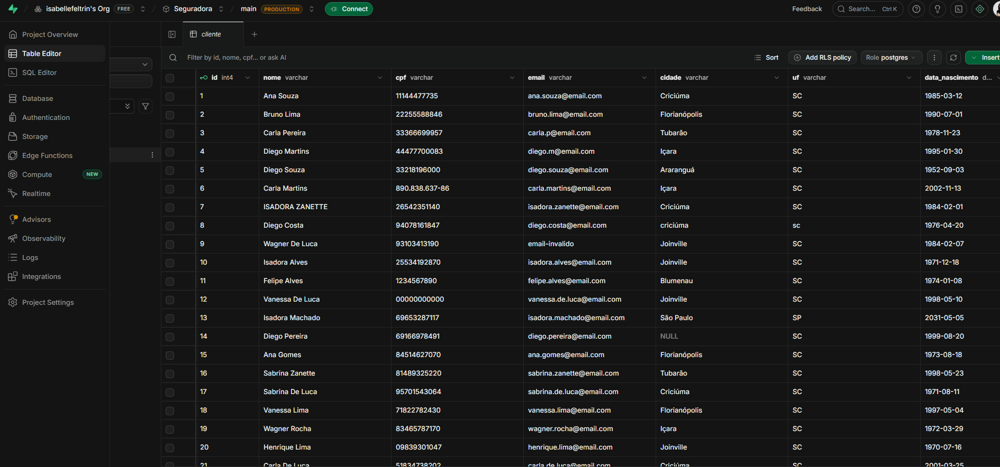

# Execução e evidências

## Passo a passo

1. Criar o banco no Supabase ([Origem](origem.md)).
2. Conectar o repositório no Databricks (Git folder) e criar o secret `seguradora/pg_uri`.
3. Criar e executar o Job ([Job](job.md)).

## Evidências

!!! note "Prints da execução"
    Substitua os arquivos em `docs/img/` pelos prints da execução de vocês.

| Evidência | Arquivo |
|---|---|
| Tabelas no Table Editor do Supabase | `img/01_supabase_tabelas.png` |
| CSVs no volume `landing.dados` (Catalog Explorer) | `img/02_landing_volume.png` |
| Schemas `bronze`, `silver` e `gold` com as tabelas | `img/03_catalogo.png` |
| `silver.dq_log` e `silver.dq_quarentena` | `img/04_data_quality.png` |
| Consulta de sinistralidade na gold | `img/05_gold_consulta.png` |
| Grafo do Job com as 5 tasks | `img/06_job_grafo.png` |
| Execução do Job com sucesso | `img/07_job_execucao.png` |

<!-- Depois de adicionar os prints, descomente:

-->

## Resultados esperados

| Camada | Tabelas | Linhas |
|---|---|---|
| Landing | 5 CSVs | 233 |
| Bronze | 5 | 233 |
| Silver | 5 + `dq_quarentena` + `dq_log` | 217 aprovadas, 16 rejeitadas |
| Gold | 4 dimensões + 2 fatos | ver [Gold](gold.md) |
