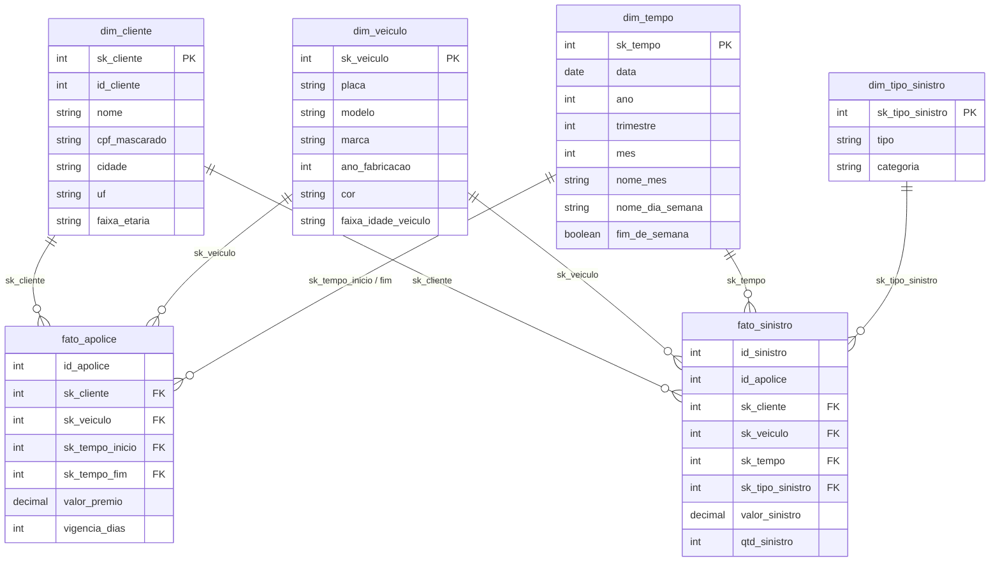

# Gold: Modelo Dimensional (Ralph Kimball)

## Processos de negócio e grão

Seguindo o processo de 4 passos de Kimball (processo → grão → dimensões → fatos):

| Processo | Fato | Grão (1 linha =) | Métricas |
|---|---|---|---|
| Emissão de apólices | `fato_apolice` | uma apólice | `valor_premio`, `vigencia_dias` |
| Ocorrência de sinistros | `fato_sinistro` | um sinistro | `valor_sinistro`, `qtd_sinistro` |

## Star schema



## Decisões de modelagem

| Decisão | Justificativa |
|---|---|
| Chaves substitutas `sk_*` inteiras | desacoplam o modelo das chaves da origem |
| Membro desconhecido `sk = -1` | nenhum fato fica sem dimensão (ex.: apólice de um carro rejeitado na silver) |
| `marca` desnormalizada em `dim_veiculo` | Kimball prefere estrela a *snowflake* |
| `dim_tempo` com chave `AAAAMMDD` e anos completos | facilita filtros e agregações por período |
| `id_apolice` / `id_sinistro` nas fatos | dimensões degeneradas, para rastrear até a origem |
| CPF mascarado na `dim_cliente` | minimização de dados pessoais (LGPD) |
| SCD Tipo 1 com carga full | simplicidade; o histórico de mudanças fica no *time travel* do Delta |
| Dimensões conformadas | `dim_cliente`, `dim_veiculo` e `dim_tempo` servem às duas fatos, permitindo *drill-across* |

## Validações automáticas

O notebook termina com `assert`s que fazem o Job falhar se a gold estiver inconsistente:

- quantidade de linhas das fatos igual à da silver;
- soma dos prêmios igual à da silver;
- toda `sk_tempo` das fatos existe na `dim_tempo`;
- `sk_cliente` única na `dim_cliente`.

| Tabela | Linhas |
|---|---|
| dim_tempo | 1.461 |
| dim_cliente | 37 (36 + desconhecido) |
| dim_veiculo | 59 (58 + desconhecido) |
| dim_tipo_sinistro | 8 (7 + desconhecido) |
| fato_apolice | 73 |
| fato_sinistro | 41 |

## Consultas de exemplo

**Sinistralidade por marca** (sinistros ÷ prêmios), cruzando as duas fatos pela dimensão conformada:

```sql
WITH premios AS (
    SELECT v.marca, SUM(f.valor_premio) AS total_premios
    FROM workspace.gold.fato_apolice f JOIN workspace.gold.dim_veiculo v USING (sk_veiculo)
    GROUP BY v.marca
), sinistros AS (
    SELECT v.marca, SUM(f.valor_sinistro) AS total_sinistros
    FROM workspace.gold.fato_sinistro f JOIN workspace.gold.dim_veiculo v USING (sk_veiculo)
    GROUP BY v.marca
)
SELECT p.marca, p.total_premios, COALESCE(s.total_sinistros, 0) AS total_sinistros,
       ROUND(COALESCE(s.total_sinistros, 0) / p.total_premios * 100, 1) AS sinistralidade_pct
FROM premios p LEFT JOIN sinistros s USING (marca)
ORDER BY sinistralidade_pct DESC;
```

**Sinistros por categoria e trimestre:**

```sql
SELECT t.ano, t.trimestre, d.categoria, COUNT(*) AS qtd, SUM(f.valor_sinistro) AS valor_total
FROM workspace.gold.fato_sinistro f
JOIN workspace.gold.dim_tempo t USING (sk_tempo)
JOIN workspace.gold.dim_tipo_sinistro d USING (sk_tipo_sinistro)
GROUP BY ALL
ORDER BY t.ano, t.trimestre, d.categoria;
```
