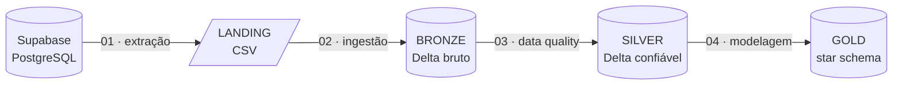

# Lakehouse com Databricks e Arquitetura Medalhão

Trabalho 3 de Engenharia de Dados (UNISATC), Prof. Jorge Luiz da Silva.
**Integrantes:** Raffael Michels Arcego · Isabelle Luiz Feltrin

## Objetivo

Construir no **Databricks Free Edition** um pipeline que leva os dados do banco `seguradora` (PostgreSQL no **Supabase**) por todas as camadas da **arquitetura medalhão**, com as etapas encadeadas em um **Job**.

| Etapa | Notebook | Entrada | Saída |
|---|---|---|---|
| 1. Extração | `01_extracao_landing` | Supabase (5 tabelas) | `landing.dados/<tabela>/<tabela>.csv` |
| 2. Ingestão | `02_bronze` | CSVs | `bronze.<tabela>` (Delta, tudo `STRING`) |
| 3. Data Quality | `03_silver` | bronze | `silver.<tabela>`, `silver.dq_quarentena`, `silver.dq_log` |
| 4. Modelagem | `04_gold` | silver | 4 dimensões + 2 fatos |
| 5. Automação | Job `pipeline_medalhao_seguradora` | — | execução sequencial das etapas |

## Evolução em relação aos trabalhos anteriores

| | Trabalho anterior | Trabalho 3 |
|---|---|---|
| Origem | SQL Server em Docker | PostgreSQL no Supabase (nuvem) |
| Armazenamento | MinIO (S3 local) | Unity Catalog: volume + tabelas Delta |
| Compute | Spark local no WSL | Databricks serverless |
| Camadas | landing e bronze | landing, bronze, silver e gold |
| Orquestração | manual (Run All) | Job com 5 tasks dependentes |
| Bronze | `inferSchema` (CPF virava `bigint`) | tudo `STRING`, tipagem na silver |

## Tecnologias

Databricks Free Edition · Delta Lake · Unity Catalog · PySpark · Supabase (PostgreSQL) · Jobs & Pipelines · MkDocs Material
