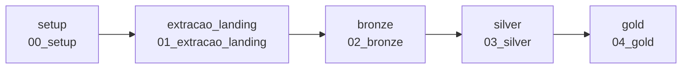

# Job (Jobs & Pipelines)

Todas as etapas são encadeadas no Job **`pipeline_medalhao_seguradora`**, com cada task dependendo da anterior. Se uma falha, as seguintes não rodam.

| Task | Notebook | Depende de |
|---|---|---|
| `setup` | `00_setup` | — |
| `extracao_landing` | `01_extracao_landing` | `setup` |
| `bronze` | `02_bronze` | `extracao_landing` |
| `silver` | `03_silver` | `bronze` |
| `gold` | `04_gold` | `silver` |

## Parâmetros do Job

| Parâmetro | Padrão | Uso |
|---|---|---|
| `catalogo` | `workspace` | repassado a todos os notebooks (widget `catalogo` do `_config`) |
| `modo_extracao` | `supabase` | `upload_externo` quando a extração roda fora do Databricks |

## Como criar

1. Conectar o repositório em **Workspace → Create → Git folder**.
2. **Jobs & Pipelines → Create → Job**.
3. Criar as 5 tasks do tipo **Notebook** (compute serverless), apontando para os notebooks do Git folder, com as dependências da tabela acima.
4. Adicionar os parâmetros do Job.
5. **Run now**.

A definição completa está em [`jobs/job_medalhao.yml`](https://github.com/isabellefeltrin/Rafa-Isa-lakehouse-databricks-supabase/blob/master/jobs/job_medalhao.yml), no formato YAML do Databricks (compatível com Asset Bundles).

## Mecanismos de segurança do pipeline

- `00_setup` é idempotente (`IF NOT EXISTS`).
- `01` falha com mensagem clara se não conseguir conectar ou se a landing estiver vazia.
- `04_gold` termina com validações (`assert`): se a gold estiver inconsistente, o Job fica vermelho.
- `max_concurrent_runs: 1` evita duas execuções simultâneas sobrescrevendo as mesmas tabelas.
