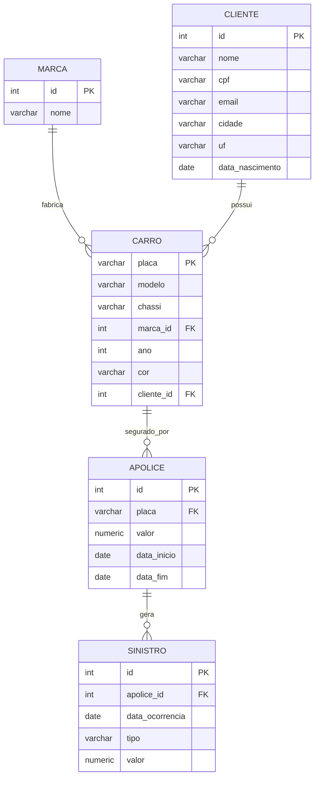

# Origem: Supabase (PostgreSQL)

O banco `seguradora` dos trabalhos anteriores foi migrado do SQL Server para o **PostgreSQL do Supabase**, para ficar acessível pela nuvem, e ampliado com a tabela `sinistro` e mais registros.

## Modelo relacional

| Tabela | Linhas | Descrição |
|---|---|---|
| marca | 9 | Fabricantes |
| cliente | 40 | Segurados |
| carro | 60 | Veículos e seus donos |
| apolice | 76 | Apólices anuais, incluindo 16 renovações |
| sinistro | 48 | Ocorrências acionadas nas apólices |

## Criação do banco

1. **New project** no Supabase.
2. **SQL Editor → New query**, colar [`sql/01_seguradora_postgres.sql`](https://github.com/isabellefeltrin/Rafa-Isa-lakehouse-databricks-supabase/blob/main/sql/01_seguradora_postgres.sql) e **Run**.
3. Conferir em **Table Editor**.

O script é gerado por `scripts/gerar_dados.py` com semente fixa: os 8 carros, 4 clientes e 8 apólices originais foram mantidos e os demais registros são sintéticos.

## Registros sujos (de propósito)

Para que a camada silver tenha o que tratar, o script insere problemas reais de qualidade:

| Tabela | Problema inserido | Tratamento esperado |
|---|---|---|
| marca | `' jeep '` | corrigido para `JEEP` |
| cliente | CPF com máscara, nome com espaços e em maiúsculas, cidade/UF minúsculas | corrigidos |
| cliente | e-mail `email-invalido` | vira `NULL` |
| cliente | CPF com dígito verificador errado, com 10 dígitos, `00000000000` | rejeitados |
| cliente | nascimento em 2031 | rejeitado |
| carro | placa minúscula, modelo com espaço, cor nula | corrigidos |
| carro | ano 2035, placa `AB12345` | rejeitados |
| apolice | prêmio negativo, fim antes do início, início em 2027 | rejeitados |
| sinistro | tipo `' colisao '`, `Colisão`, minúsculo | corrigidos |
| sinistro | valor negativo/nulo, data futura, fora da vigência, 3 duplicados | rejeitados |

## Conexão a partir do Databricks

Em **Connect** no Supabase, use a URI do **Session pooler** (IPv4), com `?sslmode=require`. Ela é guardada no secret `seguradora/pg_uri` e lida pelo notebook 01 com `dbutils.secrets.get`.

!!! warning "Rede no Free Edition"
    O Free Edition limita a saída de rede a domínios confiáveis. Se a conexão for bloqueada, o script `scripts/extrair_supabase_para_volume.py` faz a mesma extração a partir do computador local e envia os CSVs ao volume pela API do Databricks (modo `upload_externo`).
